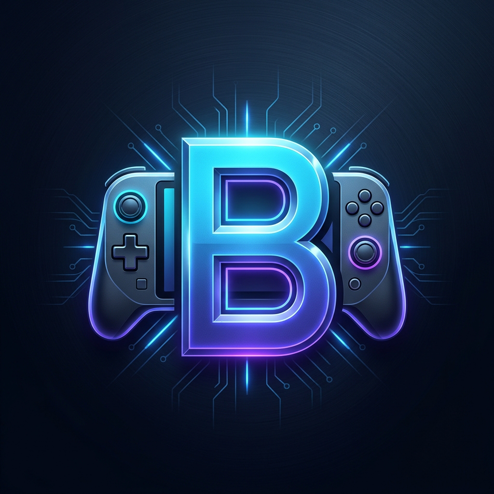

# Brama 🎮

<div align="center">



<br /><br />

[](https://apple.com)
[-FF9500.svg?style=for-the-badge)](https://apple.com)
[](https://swift.org)
[](LICENSE)
[](#roadmap)

**A SteamOS-like PC gaming frontend and compatibility layer for iOS and iPadOS.**

*Inspired by DroidDeck and Winlator on Android, reimagined natively for Apple Silicon.*

[Features](#-features) • [Architecture](#-architecture) • [Requirements](#-requirements) • [Building](#-building-from-source) • [Roadmap](#-roadmap) • [Contributing](#-contributing)

</div>

---

## 📖 Overview

**Brama** is an open-source project designed to bring a console-grade PC gaming handheld experience (similar to Steam Deck / SteamOS) directly to iPhones and iPads.

By leveraging the immense computing power of Apple Silicon (A-Series and M-Series chips), Brama combines a modern **SwiftUI Big Picture** user interface with hardware controller support, and prepares the runtime bridge for x86_64 CPU translation (via FEX-Emu / Box64) and Windows/DirectX API translation to Apple's native **Metal** graphics API.

> [!IMPORTANT]
> To execute x86_64 PC titles with acceptable framerates, iOS requires **JIT (Just-In-Time compilation)**. Brama is designed for sideloaded environments (**AltStore, SideStore, TrollStore**) or running directly from **Xcode** in Developer Debug mode.

---

## ✨ Features

- 🖥️ **SteamOS Deck UI**: Intuitive, landscape-optimized interface tailored for handheld touchscreens and external displays.
- 🎮 **Universal Controller Support**: Native integration with Apple's `GameController.framework` supporting PlayStation DualSense, Xbox Wireless, Nintendo Switch Pro, MFi controllers, and responsive on-screen virtual gamepads.
- ⚡ **Apple Silicon Metal Acceleration**: Graphics translation pipeline targeting Apple's native Metal API for maximum efficiency and thermal management.
- 📦 **Container & Game Management**: Sandboxed storage structure to manage game prefixes, dependencies, and save files cleanly.
- 📊 **Quick Access Performance Overlay**: Real-time FPS, CPU/GPU utilization, thermal status, and battery monitoring HUD.

---

## 🏗️ Architecture

```
┌────────────────────────────────────────────────────────┐
│                   Brama Handheld UI                    │
│      (SwiftUI • Steam Deck Aesthetic • Game Library)   │
└──────────────────────────┬─────────────────────────────┘
                           │
┌──────────────────────────▼─────────────────────────────┐
│                 Input & Controller Layer               │
│     (GameController.framework • Virtual Touch HUD)     │
└──────────────────────────┬─────────────────────────────┘
                           │
┌──────────────────────────▼─────────────────────────────┐
│                 Execution Core Bridge                  │
│               (Objective-C++ / C Bridge)               │
└─────────────┬────────────────────────────┬─────────────┘
              │                            │
┌─────────────▼──────────────┐ ┌───────────▼─────────────┐
│    CPU Translation Layer   │ │   Graphics Translation  │
│  (FEX-Emu / ARM64EC JIT)   │ │  (DXMT / MoltenVK ->    │
│                            │ │       Apple Metal)      │
└────────────────────────────┘ └─────────────────────────┘
```

---

## 📱 Requirements

### For End Users (Testing & Playing)
- An **iPhone** with A13 Bionic or newer, or any **iPad** with Apple Silicon (M1/M2/M4 or A12Z+).
- iOS / iPadOS 16.0 or higher.
- A sideloading method supporting JIT:
  - **SideStore** / **AltStore** (with JIT enabled)
  - **TrollStore** (iOS 14.0 - 17.0 on supported devices)
  - **Xcode Debugger** (tethered or wireless developer mode)

### For Developers
- macOS Sonoma / Sequoia or newer.
- Xcode 15.0+ or Xcode 16.0+.
- Apple Developer Account (free personal account is sufficient for development and sideloading).

---

## 🛠️ Building from Source

1. **Clone the repository:**
   ```bash
   git clone https://github.com/your-username/Brama.git
   cd Brama
   ```

2. **Open the project in Xcode:**
   ```bash
   open Brama.xcodeproj
   ```

3. **Configure Signing:**
   - Select the `Brama` project in the project navigator.
   - Go to **Signing & Capabilities**.
   - Select your personal Apple Development Team.
   - Change the Bundle Identifier if needed to match your personal prefix (e.g. `com.yourname.Brama`).

4. **Select your Destination:**
   - Choose your connected iPhone, iPad, or an iOS Simulator from the top bar.

5. **Build and Run:**
   - Press `Cmd + R` or click the **Play** button.

---

## 🗺️ Roadmap

- [x] Project architecture setup and open-source licensing (GPLv3).
- [x] **Phase 1: Deck UI & Input**
  - [x] SteamOS-style dark theme Big Picture interface.
  - [x] Game library carousel with artwork and launch action.
  - [x] Virtual on-screen touch gamepad overlay.
  - [x] GameController framework pairing (DualSense, Xbox, Switch).
- [x] **Phase 2: JIT & Sideloading Infrastructure**
  - [x] Entitlements setup (`get-task-allow`, `dynamic-codesigning`, `extended-virtual-addressing`, `increased-memory-limit`).
  - [x] SideStore/AltStore/TrollStore JIT detection and status indicator.
  - [x] GitHub Actions automated `.ipa` builder and release workflow (`.github/workflows/build-ipa.yml`).
- [x] **Phase 3: Core Runtime & PE32+ Loader Integration**
  - [x] Objective-C++ bridging layer (`BramaCore.h` / `BramaCore.mm`).
  - [x] Windows PE32 / PE32+ (`.exe`) header parser, virtual memory section mapper (`mmap`), base relocator, and IAT/DLL import resolver.
  - [x] Apple Silicon `MAP_JIT` (`pthread_jit_write_protect_np`) dynamic code cache & Wine / FEX-Emu / DXMT dynamic library loader.
- [ ] **Phase 4: Game Management & Optimizations**
  - [x] Prefix creation & Windows Registry Direct3D -> DXMT Metal override provisioning.
  - [ ] Precompiled WineKit / Box64 / DXMT `.dylib` bundle downloader & shader cache warming.

---

## 🤝 Contributing

Contributions from the open-source community are what will make Brama great!
Whether you are interested in:
- Improving the **SwiftUI** frontend and controller ergonomics.
- Working on low-level **C / C++** emulation, JIT, or Wine internals.
- Enhancing **Metal** shaders and graphics translation performance.
- Reporting bugs and compatibility results.

Please feel free to open an **Issue** or submit a **Pull Request**.

1. Fork the Project.
2. Create your Feature Branch (`git checkout -b feature/AmazingFeature`).
3. Commit your Changes (`git commit -m 'Add some AmazingFeature'`).
4. Push to the Branch (`git push origin feature/AmazingFeature`).
5. Open a Pull Request.

---

## ⚖️ License

Distributed under the **GNU General Public License v3.0 (GPLv3)**. See [`LICENSE`](LICENSE) for more information.

Under GPLv3, anyone who distributes modified versions of this software must also make the source code available under the same license, ensuring Brama remains free and open-source forever.

---

## ⚠️ Disclaimer

*Brama is an independent, community-driven open-source project and is not affiliated with, endorsed by, or associated with Valve Corporation, Steam, Steam Deck, or Apple Inc. All registered trademarks, logos, and brand names are the property of their respective owners.*
